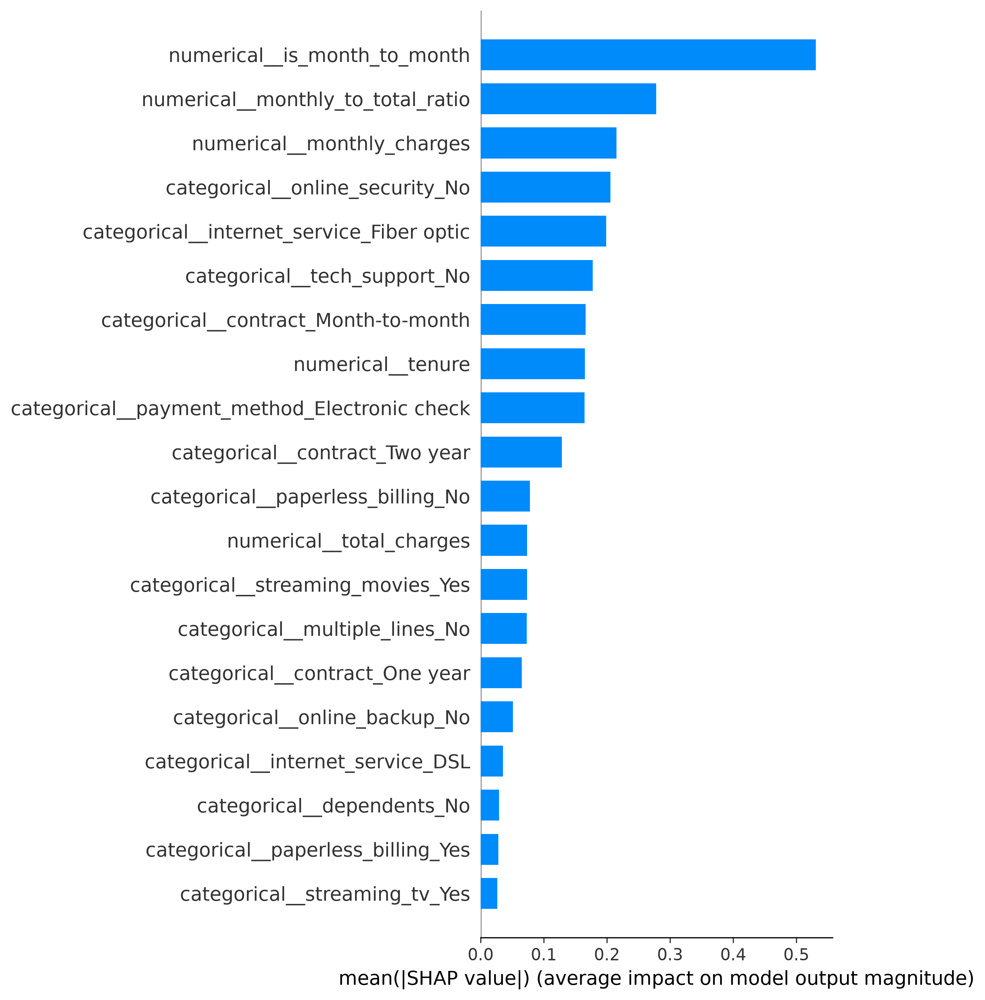
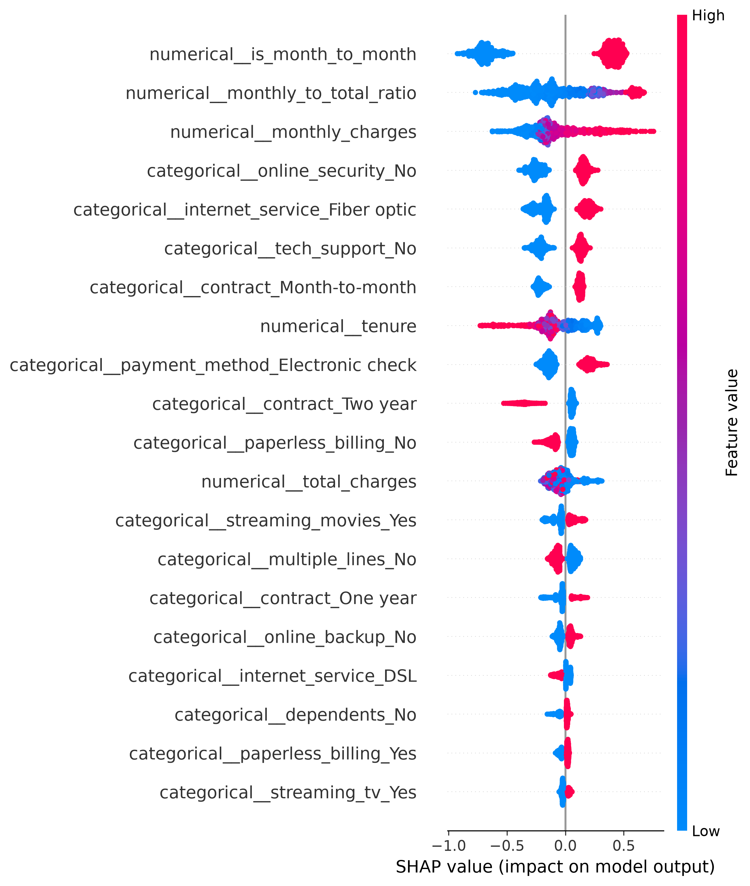
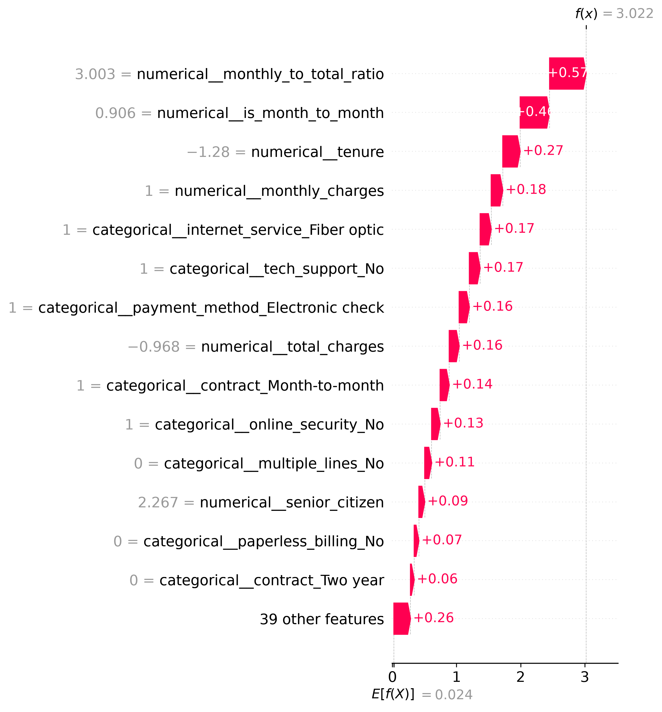

# churn_pipeline :

End-to-end customer churn prediction pipeline: raw data is loaded into PostgreSQL, cleaned with SQL transformations, used to train a model that flags at-risk customers, and shown in a dashboard.

**Status:** 
(Phase 0 done: database + raw data load)
(Phase 1 done: dbt staging and features)
(Phase 2 done: ML + explainability)
(Phase 3 done: orchestrate churn pipeline with Airflow)
(Phase 4 done: Streamlit dashboard)

## The planned stack:
- PostgreSQL (storage)
- dbt (SQL transformations and tests)
- XGBoost + SHAP (model and explainability)
- Airflow (orchestration)
- Streamlit (dashboard)

## data :
Telco Customer Churn dataset (IBM sample data) from
[Kaggle](https://www.kaggle.com/datasets/blastchar/telco-customer-churn).
## How to run (current state)

**Prerequisites:** Docker, Python 3.10+, and the required environment variables configured.

1. **Create and activate a virtual environment**, then install dependencies:

   ```bash
   pip install -r requirements.txt
   ```

2. **Start PostgreSQL:**

   ```bash
   docker compose up -d
   ```

3. **Load the raw data:**

   ```bash
   python ml/load.py
   ```

4. **Configure dbt (one time).** Create `~/.dbt/profiles.yml` outside the repository, with a profile matching `dbt_project/dbt_project.yml`:

   - type: `postgres`
   - host: `localhost`, port: `5432`
   - user / password / dbname: `churn`
   - schema: `analytics`

5. **Build and test the dbt models.** From inside `dbt_project/`:

   ```bash
   dbt debug
   dbt run
   dbt test
   ```

   This builds the staging and analytical models, including `stg_customers`, `customer_features`, and `churn_dashboard`.

6. **Train and evaluate the models:**

   ```bash
   python ml/train.py
   ```

   This handles preprocessing, trains and evaluates Logistic Regression and the baseline, weighted, and tuned XGBoost models, and tracks experiments with MLflow.

7. **Generate SHAP explainability reports:**

   ```bash
   python ml/explain.py
   ```

   Reports and visualizations are saved in `ml/reports/`.

8. **Generate customer churn predictions:**

   ```bash
   python ml/predict.py
   ```

   This loads the trained model, scores customers, and stores the results in the PostgreSQL `analytics.predictions` table.

9. **Run the Streamlit dashboard locally:**

   ```bash
   streamlit run app/dashboard.py
   ```

   Open `http://localhost:8501` to explore churn KPIs, high-risk customers, customer segments, and model explainability.

10. **Run the automated pipeline with Airflow:**

    Start Airflow using the configuration in `airflow/`:

    ```bash
    docker compose --env-file airflow/.env -f airflow/docker-compose.yaml up -d
    ```

    Open `http://localhost:8080` and trigger the `churn_daily_pipeline` DAG. It orchestrates data loading, dbt transformations and tests, and prediction generation.

---

## Project structure

```text
churn-pipeline/
├── data/
│   └── raw/                  # Source CSV (not committed)
├── dbt_project/              # dbt models, sources, and tests
├── ml/
│   ├── joblib/               # Saved models and test datasets
│   ├── reports/              # SHAP plots and ML reports
│   ├── load.py               # Raw data ingestion
│   ├── train.py              # Model training and evaluation
│   ├── explain.py            # SHAP explainability
│   ├── predict.py            # Customer churn predictions
│   └── db.py                 # Database connection
├── dags/                     # Airflow DAGs
├── airflow/                  # Airflow Docker Compose and configuration
├── app/                      # Streamlit dashboard
├── tests/
├── LEARNINGS.md              # What I did, what broke, and how I fixed it
├── requirements.txt
└── README.md
```

## Automated Pipeline Orchestration

The project uses Apache Airflow to orchestrate an end-to-end customer churn pipeline. The workflow integrates Python, PostgreSQL, dbt, and a trained XGBoost model.

### Architecture


Telco Customer Churn CSV
          |
          v
Python Data Ingestion
          |
          v
PostgreSQL: raw_customers
          |
          v
dbt Transformations
          |
          v
analytics.customer_features
          |
          v
dbt Data Quality Tests
          |
          v
Saved XGBoost Model
          |
          v
Churn Predictions
          |
          v
PostgreSQL: analytics.predictions


### Airflow DAG

**DAG ID:** `churn_daily_pipeline`

The DAG executes four tasks in sequence:

1. `load_raw_data`
2. `dbt_run`
3. `dbt_test`
4. `predict_churn`

The pipeline is scheduled daily, with catchup disabled and retries configured for failed tasks. Prediction generation depends on the successful completion of the data-quality tests.

### Technology Stack

- **Python & pandas:** Data ingestion and preprocessing.
- **PostgreSQL:** Raw data storage and prediction persistence.
- **SQLAlchemy:** Database connectivity.
- **dbt:** SQL transformations and data-quality tests.
- **Apache Airflow:** Workflow scheduling, dependencies, retries, and monitoring.
- **Docker Compose:** Containerized services and networking.
- **XGBoost & scikit-learn:** Churn classification and probability estimation.

### Running the Pipeline

Start the PostgreSQL service from the project root:

```bash
docker compose up -d
```

Start Airflow:

```bash
docker compose --env-file airflow/.env -f airflow/docker-compose.yaml up -d
```

Open the Airflow UI at `http://localhost:8080`, enable `churn_daily_pipeline` if it is paused, and trigger a DAG run.

Monitor the task statuses and logs in the Airflow UI.

### Prediction Output

The `analytics.predictions` table stores:

- `customer_id`: Customer identifier.
- `churn_probability`: Model-estimated probability of churn.
- `predicted_churn`: Binary churn prediction based on the configured threshold.
- `model_version`: Identifier for the model used.
- `scored_at`: UTC timestamp of prediction generation.

The pipeline loads an existing model for inference; model training is handled separately.

## Streamlit Dashboard

The project includes an interactive Streamlit dashboard for exploring customer churn predictions and identifying at-risk customers.

### Dashboard features

KPIs: Total customers, predicted churn rate, high-risk customers, and last scoring time.

At-risk customers: Top 20 customers ranked by churn probability.

Segment analysis: Predicted churn rates by contract type and internet service.

Interactive filters: Contract type, internet service, and minimum churn probability.

Model explainability: SHAP summary plot and model comparison results.

The dashboard reads data from the analytics.churn_dashboard dbt model, combining customer features with predictions stored by the Airflow pipeline.

### Running the Dashboard

From the project root:

streamlit run app/dashboard.py

Open the dashboard at http://localhost:8501.

The dashboard uses cached, read-only database queries and does not retrain the model or generate predictions.

## Model Explainability

### SHAP Feature Importance


### SHAP Summary Plot


### SHAP Explanation — High-Risk Customer
